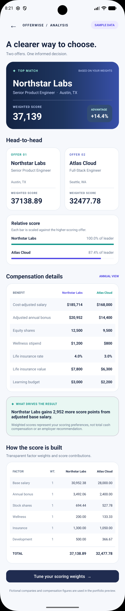

# Offerwise | Job Offer Comparison

An Android application for evaluating competing job offers using configurable compensation weights.

## Interface Preview

## My Contributions

Georgia Tech collaborative software engineering project.

- Designed the original application architecture.
- Implemented the job comparison interface.
- Developed the job-scoring functionality.

The portfolio preview uses fictional companies and compensation data.

### About This Repository

Offerwise originated as a collaborative software engineering project at Georgia Tech. I designed the original application architecture and implemented the job comparison interface and scoring functionality.

This repository serves as a visual portfolio showcase of an updated interface using fictional data. Because the original application was developed collaboratively as academic coursework I've chosen not to publicly redistribute the team's source code without permission.
